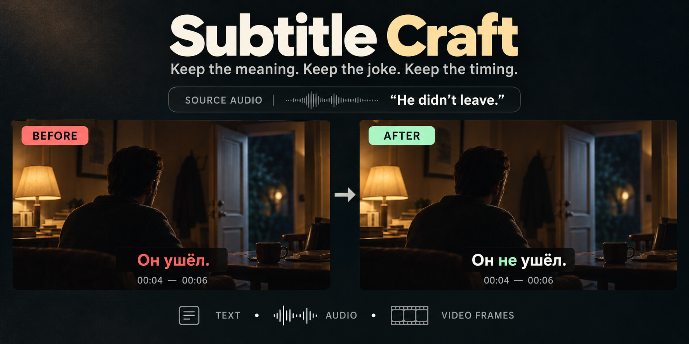

# Subtitle Craft



Keep the meaning. Keep the joke. Keep the timing.

Subtitle Craft is an agent skill for reviewing subtitle translations, backed by
small Python tools that check SRT structure and individual caption timings.
Use it when a translation sounds fluent but loses a detail, changes a character's
intent, flattens a joke, or hides a missing line.

**For:** subtitle translators, editors, and people reviewing bilingual subtitles
with a skill-compatible agent. The workflow is language-independent; the
automated number and register heuristics are tuned for English-to-Russian review.

This is a review workflow, not a subtitle library, speech-recognition model, or
one-click guarantee of a correct translation.

## Install the skill

Review [the skill instructions](SKILL.md) and [the helper scripts](scripts/)
before installing. The skill's installation name is
`subtitle-translation-audit`; Subtitle Craft is the project name.

```sh
npx skills add ncherevatenko/subtitle-craft
```

Select your agent in the installer. The Python helpers require Python 3.10 or
later and use only the standard library. To check audio or capture video frames,
your agent needs access to the completed media and suitable tools, such as
FFmpeg, a transcription or listening tool, and image inspection. Those tools
and models aren't bundled here.

## What you get

The skill combines meaning-first review with checks you can reproduce:

- **A translation review:** speakers, negation, numbers, relationships, idioms,
  jokes, technical terms, and the original level of explicitness.
- **Audio checks:** extract a short source-audio clip to check what was actually
  said, compare it with the subtitles, and flag uncertain recognition.
- **Screenshots from the video:** extract and inspect still frames to check
  signs, messages, labels, speakers, and visual context that text alone misses.
- **A second pass:** check the generated subtitles against the source, including
  complete multi-caption utterances and their grammar.
- **A delivery check:** preserve source files, record corrections, validate the
  output, and distinguish text preparation from audio and synchronization proof.

A valid SRT can still say the opposite of the source. For example, translating
“He didn't leave” as “Он ушёл” reverses the meaning without breaking the file
format. The Python validator won't detect that error; the semantic review is
essential.

## Examples to give your agent

Use these requests with files you have permission to process. Replace the
example filenames with your files, and specify the target language.

### Review a complete translation

Ask for a meaning check before stylistic polishing:

```text
Use subtitle-translation-audit to review original.en.srt against draft.ru.srt.
Check every spoken cue, including merged lines, jokes, profanity, names,
numbers, and technical terms. Preserve Russian-only signs and messages.
Save a separate reviewed SRT and a reproducible correction map. Read the
generated result in a second pass, validate it, and report unresolved lines.
Don't open or restart the player.
```

### Prepare subtitles while the video downloads

Make the evidence boundary explicit:

```text
Use subtitle-translation-audit to prepare Russian subtitles from these
completed subtitle files while the video is downloading. Don't open, probe,
or extract anything from the changing video or .part file. Preserve the
sources and their provenance. Mark the result as text-prepared, with audio,
edition matching, and synchronization still unverified. Don't start playback.
```

### Check a disputed line at a timestamp

Give the agent a time range and enough context to avoid guessing:

```text
Use subtitle-translation-audit to check 00:12:10–00:12:35 in this completed
video against the English and Russian subtitles. Identify the source audio
track before extracting a short sample. Compare the dialogue, captions, and
scene context. If recognition is unclear, say what remains uncertain instead
of inventing a line. Rebuild and recheck the whole affected utterance after
any correction. Don't change playback.
```

### Read text or identify context in a video frame

Ask for a still from the completed video when a sign, message, or visual detail
changes how you understand the scene:

```text
Use subtitle-translation-audit to inspect 00:34:46 in this completed video.
Extract a screenshot at that timestamp and a few nearby frames if needed.
Read the visible sign or message, translate it, and compare it with any forced
subtitle track. Use a short source-audio clip if the dialogue helps explain it.
Save the inspected frames and report their timestamps. Mark unreadable text
and uncertain interpretations explicitly. Don't change playback.
```

## Try the local checks

Clone the repository if you want to use the Python tools directly:

```sh
git clone https://github.com/ncherevatenko/subtitle-craft.git
cd subtitle-craft
```

### Find review candidates

Compare two SRT files by time rather than assuming their cue numbers match:

```sh
python3 scripts/subtitle_audit.py audit original.en.srt draft.ru.srt \
  --output audit.txt
```

The report flags potential missing captions, numeric differences, and softened
register. These are review prompts, not translation verdicts. Written-out
numbers, inflected words, and merged captions can produce false positives.

### Validate the file structure

Check numbering, timestamps, empty captions, and display limits:

```sh
python3 scripts/subtitle_audit.py validate reviewed.ru.srt
```

The default display limits are two lines and 42 visible characters per line.
Overlaps are warnings by default because dialogue can coexist with screen text.
Use `--strict-overlaps` only when your delivery format forbids them. Format
validation doesn't prove translation quality or audio synchronization.

### Compare every timing boundary

Check every start and end against a reference track whose correspondence you
have already established:

```sh
python3 scripts/subtitle_timing.py check reference.ru.srt reviewed.ru.srt
```

For verified one-to-one timing transfer, use the guarded `bind` command:

```sh
python3 scripts/subtitle_timing.py bind \
  --baseline original.ru.srt \
  --reference embedded.ru.srt \
  --prepared reviewed.ru.srt \
  --output release-bound.ru.srt \
  --report timing-binding.json
```

Binding requires corresponding visible text in the baseline and reference, equal
cue counts, and unchanged baseline timings in the prepared translation. It
refuses existing output paths. Splits, merges, added screen text, and different
cuts need an explicitly reviewed mapping instead. See
[release modes and evidence](references/release-modes.md).

## A small, reproducible example

The [examples](examples/) contain two synthetic captions, not dialogue taken
from a film. The draft deliberately changes “6” to “9” and loses the negation
in “He didn't leave.” Compare it with the source:

```sh
python3 scripts/subtitle_audit.py audit \
  examples/source.en.srt examples/draft.ru.srt
```

The report flags `NUMERIC 6`. It doesn't flag the reversed meaning in the second
caption. That is the difference between an automated check and semantic review.
The [reviewed version](examples/reviewed.ru.srt) fixes both problems while
preserving the original time spans:

```sh
python3 scripts/subtitle_audit.py validate examples/reviewed.ru.srt \
  --expected-cues 2
python3 scripts/subtitle_timing.py check \
  examples/draft.ru.srt examples/reviewed.ru.srt
```

Validation returns no errors or warnings, and the timing check returns
`"ok": true`. The timing result means both captions kept their start and end
times; it doesn't independently prove that the translation is correct.

The regression tests build additional synthetic files in temporary directories:

```sh
python3 -m unittest discover -s tests -v
```

One timing test uses three captions: “Стой!”, “Он не придёт.”, and “Место
встречи.” It applies different reference offsets to the captions and verifies
every start and end. A second test deliberately changes a single end time by
one millisecond and requires the check to fail.

Explore [the audit tests](tests/test_subtitle_audit.py) and
[the timing tests](tests/test_subtitle_timing.py) for more executable examples.
These tests check software behavior, not a model's translation accuracy.

## Limits and privacy

Keep the checks proportional to the evidence you actually have:

- Text preparation doesn't establish a match to a particular video release.
- Sampled automatic transcription isn't a complete listening pass, and related
  models agreeing with each other isn't independent proof.
- Replacing a subtitle file on disk doesn't prove the player loaded it.
- A translation request doesn't authorize downloading media, changing networks,
  starting playback, or interrupting another title.
- The Python helpers run locally and make no network requests. Your agent or
  transcription provider may process supplied content under its own settings.
- This repository includes instructions, code, and synthetic tests, not films,
  full subtitle tracks, private transcripts, or credentials.

## Help maintain and improve it

Useful contributions make a specific failure easier to reproduce and prevent:

1. [Open an issue](https://github.com/ncherevatenko/subtitle-craft/issues) with
   the expected behavior, the actual result, and a small example.
2. Suggest a focused correction to the instructions or helper behavior.
3. Submit a pull request with a synthetic regression test when code changes.
4. Run the test command above and explain what your change verifies.

For translation examples, include only the short excerpt needed to explain the
problem and enough context to identify the speaker and intended meaning. Don't
post copyrighted media, complete subtitle tracks, private paths, personal data,
credentials, or unredacted session logs.

High-value areas include multilingual number handling, better false-positive
dispositions, idiom and register review, mixed dialogue and screen captions,
and stronger release-binding tests. Contributions don't need to be large; a
clear counterexample is a useful start.

## License

The skill, helper code, documentation, and synthetic examples are available under
the [MIT License](LICENSE). This license doesn't grant rights to films or
third-party subtitles you process with the skill.

## Next steps

Start with one scene, inspect the resulting corrections, and expand to the full
requested range. Keep unresolved wording visible, preserve the original files,
and verify the completed release before claiming synchronized delivery.
